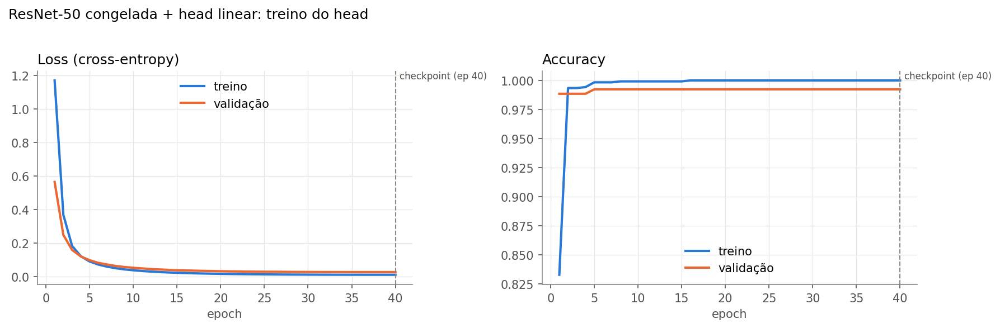
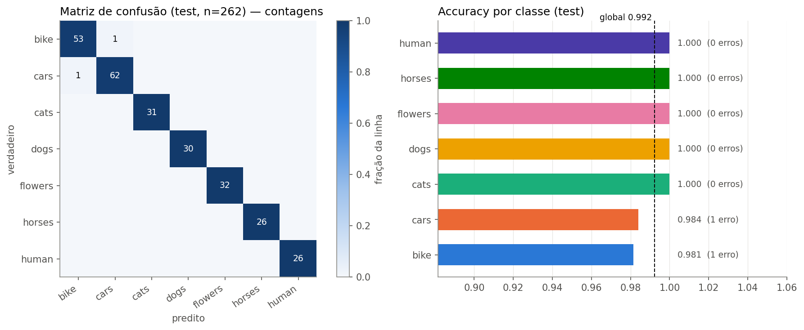
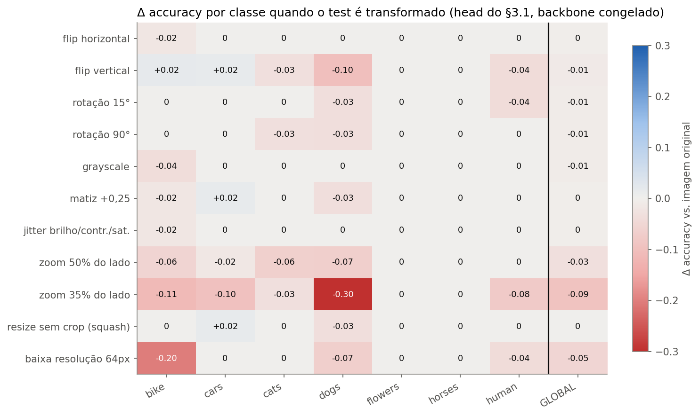
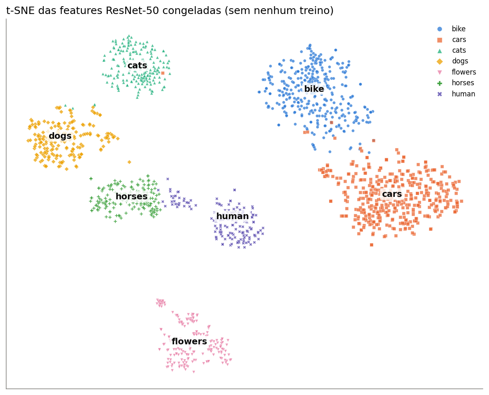
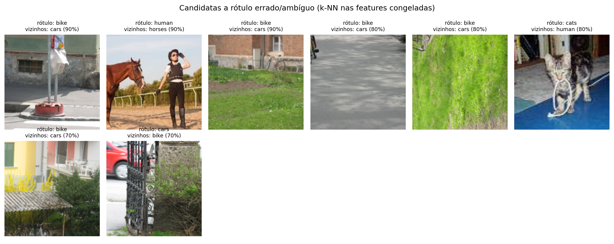

# A3 — Classificador por Transfer Learning com CNN Pré-treinada

> Até onde chega uma ResNet-50 **congelada**, com só a última camada treinada, em 7 categorias de objetos, e quais
> augmentations ajudariam ou atrapalhariam cada classe, **medido em vez de suposto**. Spoiler: 99,2% de accuracy
> com 14 mil parâmetros treináveis. O trabalho interessante estava em auditar o dataset e em descobrir que o recorte
> agressivo, e não a cor, é o que derruba o modelo.

<p>


</p>

Projeto da disciplina **Deep Learning & Computer Vision** (atividade 3). Entregável autossuficiente: um único notebook
que roda do início ao fim no **Google Colab (GPU T4)** sem edições.

---

## Destaques

- **Feature extraction correta e verificada.** Backbone com `requires_grad=False` e em `eval()`, `fc` trocado por
  `Linear(2048, 7)`: **14.343 parâmetros treináveis (0,06%)**, um treino. Uma célula prova que o modelo completo e o
  head sobre as features em cache dão as mesmas probabilidades (Δ < 1e-6, precisão float32).
- **Accuracy de test 0,992** (260/262), F1 macro 0,995. Cinco classes com 1,000; os dois erros são cenas de rua
  ambíguas (`bike` ↔ `cars`). O resultado é **idêntico em 5 seeds**, porque o head linear com L2 é um problema convexo.
- **Dataset auditado antes de treinar.** Foram encontradas uma cópia inteira em `data/data`, **39 duplicatas exatas e
  22 near-duplicates** (por hash perceptual) e **viés de fonte** (cada classe tem formato e resolução próprios). Também
  apareceu `human` com 10% de fotos P&B, contra ≤ 4% nas outras classes.
- **Augmentation com evidência, por classe.** 11 transformações aplicadas ao test mostram o que cada classe tolera:
  **zoom agressivo derruba `dogs` −0,30, `bike` −0,11, `cars` −0,10**; cor e grayscale quase não afetam, **nem
  `flowers`**; flip vertical prejudica animais e pessoas.
- **Normalização e augmentation testadas, não só discutidas.** Sem a normalização ImageNet, −0,6 p.p. Com augmentation
  no treino do head, o test limpo não melhora (teto), cor forte piora `bike`, e a robustez sobe até +1,3 p.p. (escala →
  zoom; combinada → baixa resolução). É o limite do que um backbone congelado permite.
- **Roda em ~6 min na T4** (medido no Colab: 0,86 GB de VRAM de pico).

## O que o projeto faz

| Etapa | Entrada | Saída |
|---|---|---|
| **Auditoria** | 1.803 arquivos em 7 pastas | dedup MD5 + dHash, perfil de fonte/resolução/P&B, split estratificado 70/15/15 |
| **Escolha do modelo** | ResNet-50 vs. EfficientNet-B0 | parâmetros, GFLOPs, top-1 ImageNet, vazão medida |
| **§3.1 Feature extraction** | features 2048-d da ResNet-50 congelada | curvas por epoch, accuracy global e por classe, matriz de confusão, 5 seeds |
| **Diagnóstico** | features + head ImageNet original | classes ImageNet por classe, t-SNE, galeria de erros, vazamento, auditoria de rótulos |
| **§3.2 Melhorias** | test transformado · 3 normalizações · 4 famílias de augmentation | Δ accuracy por classe × transformação, robustez, tabela de recomendação |
| **§4 FE vs. FT** | ResNet-50 vs. EfficientNet-B0 | quando usar feature extraction ou fine-tuning |

Pipeline: **download → dedup (MD5 + dHash) → split 70/15/15 → features ResNet-50 (1 passada) → head linear (40
epochs) → avaliação no test → sensibilidade / normalização / augmentation → comparação de backbones**.

## Dataset

Kaggle [`pavansanagapati/images-dataset`](https://www.kaggle.com/datasets/pavansanagapati/images-dataset). São 7
classes: `bike`, `cars`, `cats`, `dogs`, `flowers`, `horses`, `human`. Download via `kagglehub`, sem credenciais; se
falhar, o notebook pede o `kaggle.json`, que **nunca é versionado** (está no `.gitignore`).

| | bike | cars | cats | dogs | flowers | horses | human | total |
|---|---|---|---|---|---|---|---|---|
| arquivos | 365 | 420 | 202 | 202 | 210 | 202 | 202 | 1.803 |
| após dedup | 360 | 420 | 202 | 201 | 210 | 177 | 172 | **1.742** |
| treino / val / test | 252/54/54 | 294/63/63 | 141/30/31 | 141/30/30 | 147/31/32 | 124/27/26 | 120/26/26 | 1.219/261/262 |
| formato de origem | BMP 640×480 | BMP 640×480 | JPG ~460×374 | JPG ~440×374 | PNG 128×128 | JPG variado | JPG variado | |

> **Limitação conhecida:** cada classe vem de uma fonte diferente (`bike`/`cars` são cenas de rua do Graz-02, as
> flores são PNG de 128 px etc.). Isso torna o problema mais fácil do que seria com fontes misturadas. O notebook
> testa se o modelo explora a resolução como atalho (§3.2.a: não explora).

## Por que ResNet-50 em feature extraction

- **Domínio:** as 7 classes estão no vocabulário do ImageNet. Decodificando o head original: `bike` → *mountain bike*
  (45%), `horses` → *sorrel* (71%), `cats` → *Egyptian cat*/*tabby*. O t-SNE das features separa as 7 classes **sem
  treino**.
- **Tamanho:** 1.219 imagens de treino contra 23,5 M parâmetros no backbone. Treinar só o head (~12 parâmetros por
  imagem) evita overfitting.
- **T4:** sem backward pelo backbone, é só uma passada de inferência (0,82 GB de VRAM com batch 64, ~290 imagens/s). A ResNet-50 tem o maior top-1
  dos candidatos (80,9% com os pesos V2), e a EfficientNet-B0 erra 4 imagens de test contra 2.
- **7 classes:** `Linear(2048, 7)` basta, sem pressão por head ou backbone maiores.

## Estrutura

```
A3_cnn_kaggle/
├── A3_cnn_kaggle.ipynb   # ENTREGÁVEL — roda sozinho no Colab T4 (salvo já executado)
├── RELATORIO_A3.md       # seção A3 do relatório técnico
├── figures/              # figuras geradas pelo notebook + results.json (todas as métricas)
├── data/                 # dataset (gitignored)
├── requirements.txt
├── README.md
└── LICENSE
```

## Setup

```bash
python -m venv venv
source venv/Scripts/activate      # Windows Git Bash;  Linux/Mac: source venv/bin/activate
pip install -r requirements.txt
```

## Rodar

**Colab (recomendado, GPU T4).** Abrir `A3_cnn_kaggle.ipynb`, selecionar o runtime **T4** e executar todas as
células. O dataset (~1 GB) é baixado via `kagglehub`. A última célula compacta `figures/` + `results.json` e baixa o zip.

| Recurso | Medido (Colab T4) |
|---|---|
| Tempo total | **~5,7 min** (dataset ~1,1 min · extração das augmentations ~2 min · treinos dos heads ~1 min · demais < 30 s cada) |
| VRAM (pico) | 0,86 GB |
| RAM | ~2,9 GB |
| Disco | ~1,1 GB |

O custo dominante é a extração das 4 famílias de augmentation (3 vistas × 1.219 imagens cada). Em CPU, a execução
completa leva ~32 min.

**Local.** Executar o notebook a partir desta pasta; o `kagglehub` reaproveita o cache do download. Em CPU, para
testar o fluxo mais rápido, reduzir `K_VIEWS` (§3.2.c).

## Resultados

**§3.1 Feature extraction (test, n = 262):**

| Classe | bike | cars | cats | dogs | flowers | horses | human | **Global** |
|---|---|---|---|---|---|---|---|---|
| Accuracy | 0,981 | 0,984 | 1,000 | 1,000 | 1,000 | 1,000 | 1,000 | **0,992** |

Balanced accuracy 0,995 · F1 macro 0,995 · validação 0,992 · desvio-padrão entre 5 seeds = 0. Resultado idêntico
em CPU e na T4.

| Curvas de treino do head | Matriz de confusão e accuracy por classe |
|---|---|
|  |  |

**§3.2 Sensibilidade por classe** (Δ accuracy quando o test é transformado):

| Transformação | Classes mais afetadas | Global |
|---|---|---|
| flip horizontal | — | −0,004 |
| flip vertical | dogs −0,10 · human −0,04 | −0,011 |
| grayscale / matiz / jitter | bike −0,02 a −0,04 (flowers 0) | −0,004 a −0,008 |
| zoom 35% do lado | **dogs −0,30 · bike −0,11 · cars −0,10** · human −0,08 | **−0,092** |
| baixa resolução 64 px | **bike −0,20** | −0,053 |
| resize sem crop | — | 0,000 |



**Augmentation no treino do head** (backbone congelado, 3 vistas por imagem, 3 seeds):

| Augmentation | Test limpo | Test transformado (média) |
|---|---|---|
| nenhuma | 0,9924 | 0,9721 |
| geométrica | 0,9924 | 0,9755 |
| cor | **0,9898** (`bike` 0,981 → 0,969) | 0,9717 |
| **escala** | 0,9924 | **0,9762** (zoom 35%: +1,3 p.p.; zoom 50%: +1,2 p.p.) |
| combinada | 0,9924 | 0,9749 (baixa resolução: +1,3 p.p.) |

Numa execução anterior em CPU, com outras vistas aleatórias, a combinada ficou em primeiro e a escala deu +2,5 p.p. no
zoom. A ordem entre as famílias varia ~1 p.p.; os padrões (limpo sem ganho, escala → zoom, combinada → baixa
resolução, cor sozinha sem ganho) se repetem.

**Normalização:** ImageNet 0,9924 · estatísticas do dataset 0,9924 · sem normalização 0,9860 ± 0,0018.

| t-SNE das features congeladas (sem treino) | Auditoria: `bike` sem bicicleta após o center crop |
|---|---|
|  |  |

**Recomendação de augmentation:** flip horizontal, rotação ±10°, `RandomResizedCrop(scale=(0,5; 1))` (nunca o 0,08
padrão: corta `cars` e `bike` e confunde `dogs`), jitter leve, grayscale p=0,1 (remove o atalho "P&B ⇒ human") e
normalização ImageNet. Sem flip vertical e sem cor forte (prejudica `bike`).

## Status (checklist da rubrica)

- [x] CNN pré-treinada carregada, backbone **congelado**, head substituído pelo nº de classes, feature extraction com um treino (§3.1)
- [x] Curvas de loss e accuracy por epoch (§3.1)
- [x] Accuracy por classe + accuracy global, matriz de confusão (§3.1)
- [x] Escolha do modelo justificada: Colab T4, nº de classes, domínio, com comparação medida (§2, §4)
- [x] ≥3 estratégias de augmentation (geométrica, cor, escala, normalização) com justificativa por classe e evidência experimental (§3.2)
- [x] Discussão escrita: feature extraction vs. fine-tuning por tamanho e domínio do dataset (§4)

## Uso de IA

Desenvolvido com apoio de **Claude (Anthropic), modelo Claude Opus 5.5, via Claude Code**, conforme a política
"Sinal Verde" da disciplina: estruturação do projeto, implementação de apoio (auditoria do dataset, dedup perceptual,
pipeline de feature extraction com cache, experimentos de sensibilidade, normalização e augmentation), revisão de código
e redação de apoio das análises. Todo o código foi executado, revisado e validado pelo autor, e as análises foram
verificadas contra os resultados reais.

## Referências

- He, K. et al. (2016). Deep Residual Learning for Image Recognition. *CVPR*.
- Tan, M. & Le, Q. (2019). EfficientNet. *ICML*.
- Deng, J. et al. (2009). ImageNet. *CVPR*. · Wightman, R. et al. (2021). ResNet strikes back. *arXiv:2110.00476*.
- Yosinski, J. et al. (2014). How transferable are features in deep neural networks? *NeurIPS*.
- Kornblith, S., Shlens, J. & Le, Q. (2019). Do Better ImageNet Models Transfer Better? *CVPR*.
- Shorten, C. & Khoshgoftaar, T. (2019). A survey on Image Data Augmentation. *Journal of Big Data*.
- Geirhos, R. et al. (2020). Shortcut learning in deep neural networks. *Nature Machine Intelligence*.
- Opelt, A. et al. (2006). Generic object recognition with boosting (Graz-02). *IEEE TPAMI*.
- van der Maaten, L. & Hinton, G. (2008). t-SNE. *JMLR*.

## Licença

MIT — ver [`LICENSE`](LICENSE).
