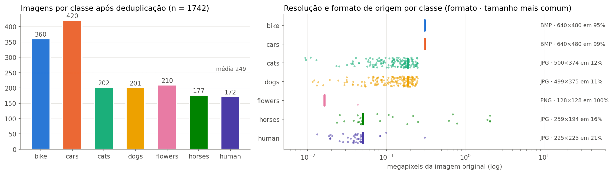
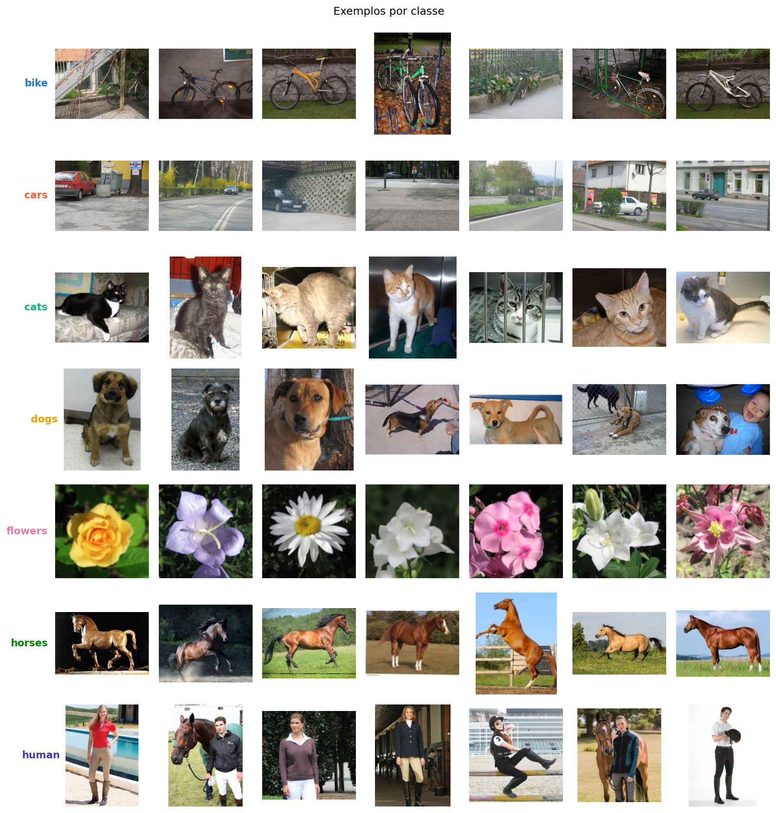
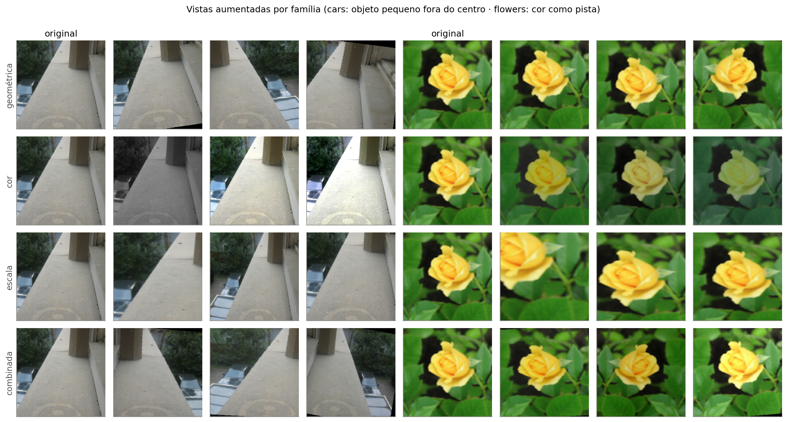
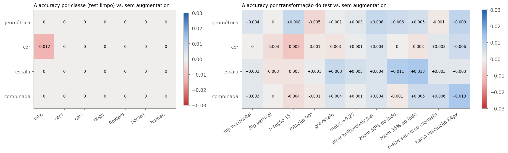

## 3. Classificador com CNN Pré-treinada

> Notebook: `A3_cnn_kaggle.ipynb` · Repositório: https://github.com/GiovanniAsantos/A3_cnn_transfer_learning
> Execução completa no Google Colab (GPU T4): ~5,7 min, pico de VRAM de 0,86 GB, RAM de 2,9 GB.

### 3.1 Definição do problema

O objetivo é construir um classificador supervisionado para o dataset `pavansanagapati/images-dataset` (Kaggle),
com ~1.800 imagens em 7 categorias de objetos: `bike`, `cars`, `cats`, `dogs`, `flowers`, `horses` e `human`. O
enunciado impõe **transfer learning por feature extraction**:

- carregar uma CNN pré-treinada;
- congelar o backbone;
- substituir o classification head pelo número de classes;
- treinar apenas a nova camada, em um único treino.

Devem ser reportadas a accuracy global, a accuracy por classe e as curvas de loss e accuracy por epoch. Na segunda
parte, a tarefa é discutir quais augmentations seriam benéficas (geométrica, cor, escala, normalização) e para quais
classes cada uma poderia introduzir distorções.

**Auditoria do dataset.** Antes de treinar, o dataset foi auditado. Quatro achados mudaram decisões:

| Achado | Evidência | Decisão |
|---|---|---|
| Cópia integral do dataset em `data/data/` | Hashes MD5 idênticos aos do nível de cima | Usar só o nível de cima |
| Duplicatas | **39 exatas** (MD5; 19 em `horses`, 19 em `human`) e **22 near-duplicates**, a mesma foto re-codificada (hash perceptual dHash, Hamming ≤ 3) | Remover as 61 **antes** do split, para evitar que a mesma foto esteja no treino e no teste |
| Viés de fonte | `bike`/`cars`: BMP 640×480 (cenas de rua do Graz-02); `flowers`: PNG 128×128; `cats`/`dogs`: JPG ~450×374; `horses`/`human`: JPG de tamanhos variados | Redimensionar tudo para 224 px e testar se a resolução vira atalho (§3.3) |
| Fotos em tons de cinza | `human` tem **10,4%** de fotos P&B ou sépia; as demais classes têm ≤ 4,3% | Motiva a augmentation por grayscale (§3.4) |

Restaram **1.742 imagens**, divididas em treino/validação/teste **70/15/15 estratificado**: 1.219 / 261 / 262. O
teste só foi usado para os números finais.

| | bike | cars | cats | dogs | flowers | horses | human |
|---|---|---|---|---|---|---|---|
| treino | 252 | 294 | 141 | 141 | 147 | 124 | 120 |
| validação | 54 | 63 | 30 | 30 | 31 | 27 | 26 |
| teste | 54 | 63 | 31 | 30 | 32 | 26 | 26 |

### 3.2 Decisões técnicas e justificativas

**Escolha do modelo: ResNet-50 (`IMAGENET1K_V2`).** Os candidatos compatíveis com a T4 foram comparados com os
metadados oficiais do torchvision:

| Modelo | Parâmetros | GFLOPs | Top-1 ImageNet | Dimensão das features |
|---|---|---|---|---|
| **ResNet-50** | 25,6 M | 4,09 | **80,9%** | 2048 |
| EfficientNet-B0 | 5,3 M | 0,39 | 77,7% | 1280 |

A escolha considerou três fatores:

- **Domínio.** As 7 classes são objetos do cotidiano, cobertos pelo vocabulário do ImageNet, que tem raças de cães e
  gatos, *mountain bike*, *sports car*, *daisy*, *sorrel* etc. Com essa sobreposição, o que importa é a qualidade da
  representação congelada, e a ResNet-50 tem o maior top-1.
- **Colab T4.** Em feature extraction não há backward pelo backbone nem estados do otimizador para ele: é só uma
  passada de inferência, com 0,82 GB de VRAM em batch 64 (medido), bem abaixo dos 15 GB da T4. Os 10× mais FLOPs que a
  EfficientNet-B0 custam segundos com ~1,7 mil imagens.
- **Número de classes.** Com 7 classes, o head é um `Linear(2048, 7)`: **14.343 parâmetros treináveis**, cerca de 12
  por imagem de treino. É pouco para um head linear, e o risco de overfitting é controlável.

A EfficientNet-B0 foi mantida como comparação (§3.3). Ela seria a escolha certa para edge ou mobile, ou para um
fine-tuning completo com pouca memória.

**Feature extraction.**

- **Congelamento:** todos os parâmetros com `requires_grad = False` e o backbone em `eval()`, para que o BatchNorm use
  as estatísticas do ImageNet sem atualizá-las.
- **Novo head:** `model.fc` (1000 classes) foi substituído por `nn.Linear(2048, 7)`. Os únicos parâmetros treináveis
  são `fc.weight` e `fc.bias`: 0,06% do modelo.
- **Pré-processamento:** o padrão dos pesos, `Resize(256) → CenterCrop(224) → Normalize(média e desvio do ImageNet)`.
- **Treino do head:** AdamW (learning rate 1e-3, weight decay 1e-4), scheduler cosine, 40 epochs, batch 64,
  cross-entropy. O checkpoint escolhido é o de menor loss de validação.
- **Cache de features:** como o backbone está congelado e o treino não usa augmentation, a saída de cada imagem é
  sempre a mesma. As features (2048-d, após o global average pool) foram extraídas uma única vez. Treinar o `fc` sobre
  esse cache é matematicamente equivalente a treinar o modelo completo com backbone congelado. Uma célula de verificação
  confirma isso: o modelo completo aplicado às imagens e o head aplicado ao cache dão as mesmas probabilidades
  (Δ máximo < 1e-6, a precisão do float32).
- **Robustez:** o mesmo treino foi repetido com 5 seeds.

**Diagnóstico complementar.**

- **Decodificação ImageNet:** o head ImageNet original foi aplicado às mesmas features para ver quanto do domínio já
  está no vocabulário do ImageNet.
- **t-SNE** das features congeladas.
- **Vazamento residual:** busca de vizinhos de treino com similaridade de cosseno ≥ 0,95 para cada imagem de teste.
- **Auditoria de rótulos:** imagens cujos 10 vizinhos mais próximos são, em maioria, de outra classe.

**Análise de melhorias (§3.2 do enunciado) com evidência.** Em vez de argumentar só no papel, foram rodados três
experimentos que mantêm o backbone congelado:

1. **Sensibilidade por classe.** 11 transformações determinísticas aplicadas às imagens de teste: flip horizontal e
   vertical, rotação de 15° e 90°, grayscale, deslocamento de matiz, jitter de brilho/contraste/saturação, zoom central
   de 50% e 35% do lado, resize sem crop e baixa resolução (64 px). Para cada uma, mede-se a accuracy **por classe** do
   head treinado.
2. **Normalização.** Features extraídas com a normalização do ImageNet, sem normalização e com média e desvio do
   próprio dataset; o mesmo head é treinado em cada versão (3 seeds).
3. **Augmentation no treino do head.** Para cada família, foram geradas 3 vistas aleatórias por imagem de treino. O
   head foi treinado com as imagens originais mais as vistas e avaliado no teste limpo e no teste transformado do
   experimento 1. As famílias:
   - **geométrica:** flip horizontal, rotação ±10° e recorte aleatório;
   - **cor:** color jitter e grayscale aleatório (p = 0,2);
   - **escala:** `RandomResizedCrop`, com área de 25% a 100%;
   - **combinada.**

### 3.3 Resultados

**Feature extraction (teste, n = 262).**

| Classe | n | Accuracy (validação) | **Accuracy (teste)** | Erros no teste |
|---|---|---|---|---|
| bike | 54 | 1,000 | **0,981** | 1 (→ cars) |
| cars | 63 | 1,000 | **0,984** | 1 (→ bike) |
| cats | 31 | 0,967 | **1,000** | 0 |
| dogs | 30 | 1,000 | **1,000** | 0 |
| flowers | 32 | 1,000 | **1,000** | 0 |
| horses | 26 | 0,963 | **1,000** | 0 |
| human | 26 | 1,000 | **1,000** | 0 |
| **Global** | **262** | **0,992** | **0,992** | **2** |

No teste, a balanced accuracy é 0,995 e o F1 macro 0,995. Entre as 5 seeds do head, o desvio-padrão foi **0**.

**O que o backbone já reconhece.** Classes ImageNet mais previstas pelo head original para cada classe:

| Classe | Top-3 classes ImageNet | Nº de classes ImageNet distintas |
|---|---|---|
| bike | mountain bike (45%) · bicycle-built-for-two (29%) · tricycle (8%) | 30 |
| cars | beach wagon (18%) · minivan (16%) · cab (8%) | 73 |
| cats | Egyptian cat (32%) · tabby (30%) · tiger cat (9%) | 24 |
| dogs | American Staffordshire terrier (10%) · Labrador retriever (7%) · kelpie (5%) | 68 |
| flowers | daisy (36%) · pot (20%) · earthstar (8%) | 22 |
| horses | sorrel (71%) · Saluki (9%) · Great Dane (4%) | 24 |
| human | suit (17%) · sorrel (10%) · Windsor tie (8%) | 48 |

**Vazamento e rótulos.**

- Após a deduplicação, nenhuma imagem de teste tem vizinho de treino com cosseno ≥ 0,98. As duas com cosseno ≥ 0,95
  são fotos diferentes (outra margarida, outro cavalo alazão). Sem elas, a accuracy é 0,9923.
- A auditoria de rótulos marcou 8 de 1.742 imagens, mostradas abaixo.

**Sensibilidade por classe ao transformar o teste** (Δ accuracy em relação à imagem original; 1 imagem = 0,38 p.p.
no global):

| Transformação | bike | cars | cats | dogs | flowers | horses | human | **Global** |
|---|---|---|---|---|---|---|---|---|
| flip horizontal | −0,019 | 0 | 0 | 0 | 0 | 0 | 0 | −0,004 |
| flip vertical | +0,018 | +0,016 | −0,032 | **−0,100** | 0 | 0 | −0,038 | −0,011 |
| rotação 15° | 0 | 0 | 0 | −0,033 | 0 | 0 | −0,038 | −0,008 |
| rotação 90° | 0 | 0 | −0,032 | −0,033 | 0 | 0 | 0 | −0,008 |
| grayscale | −0,037 | 0 | 0 | 0 | 0 | 0 | 0 | −0,008 |
| matiz +0,25 | −0,019 | +0,016 | 0 | −0,033 | 0 | 0 | 0 | −0,004 |
| jitter brilho/contraste/saturação | −0,019 | 0 | 0 | 0 | 0 | 0 | 0 | −0,004 |
| zoom 50% do lado | −0,056 | −0,016 | −0,064 | −0,067 | 0 | 0 | 0 | −0,031 |
| zoom 35% do lado | **−0,111** | **−0,095** | −0,032 | **−0,300** | 0 | 0 | −0,077 | **−0,092** |
| resize sem crop | 0 | +0,016 | 0 | −0,033 | 0 | 0 | 0 | 0,000 |
| baixa resolução 64 px | **−0,204** | 0 | 0 | −0,067 | 0 | 0 | −0,038 | −0,053 |

**Normalização** (3 seeds):

| Normalização | Accuracy no teste | F1 macro |
|---|---|---|
| ImageNet (padrão dos pesos) | **0,9924** | 0,995 |
| Média e desvio do dataset | 0,9924 | 0,995 |
| Sem normalização ([0,1]) | 0,9860 ± 0,0018 | 0,989 |

A média e o desvio do dataset (0,485 / 0,453 / 0,396) são praticamente os do ImageNet (0,485 / 0,456 / 0,406).

**Augmentation no treino do head** (backbone congelado, 3 vistas por imagem, média de 3 seeds):

| Augmentation | Teste limpo | Teste transformado (média) | Maior ganho | Maior perda |
|---|---|---|---|---|
| Nenhuma | 0,9924 | 0,9721 | — | — |
| Geométrica | 0,9924 | 0,9755 | baixa resolução +0,9 · rotação 15° +0,8 · jitter +0,8 p.p. | rotação 90° −0,5 p.p. |
| Cor | **0,9898** (`bike` 0,969) | 0,9717 | baixa resolução +0,6 · jitter +0,4 p.p. | rotação 15° −0,9 p.p. |
| **Escala** | 0,9924 | **0,9762** | **zoom 35% +1,3 · zoom 50% +1,2** · grayscale +0,8 p.p. | flip vertical −0,3 · rotação 15° −0,3 p.p. |
| Combinada | 0,9924 | 0,9749 | **baixa resolução +1,3** · zoom 35% +0,6 · squash +0,6 p.p. | rotação 15° −0,4 p.p. |

Numa execução anterior em CPU, com outras vistas aleatórias, a combinada ficou em primeiro (0,9769) e a escala deu
+2,5 p.p. no zoom 35%. A ordem entre as famílias varia ~1 p.p. entre execuções, mas os padrões se repetem.

**ResNet-50 vs. EfficientNet-B0** (mesmo protocolo, 3 seeds):

| Backbone | Parâmetros treináveis | Tempo de extração (T4) | Accuracy no teste | F1 macro |
|---|---|---|---|---|
| **ResNet-50** | 14.343 | 7,8 s | **0,9924** | **0,995** |
| EfficientNet-B0 | 8.967 | 4,8 s | 0,9847 | 0,984 |

### 3.4 Análise crítica

**Feature extraction resolve o problema, e o motivo está nas features.** A accuracy de validação já é 0,989 no
primeiro epoch: o head só precisa encontrar hiperplanos num espaço que já separa as classes. Duas evidências
independentes mostram isso:

- o t-SNE separa as 7 classes **sem nenhum treino**;
- o head ImageNet original já reconhece *mountain bike*, *tabby* e *sorrel* nas classes certas.

As curvas não mostram overfitting: a loss de validação cai monotonicamente até 0,028, e o gap de treino (0,012) é o
esperado para um modelo de 14 mil parâmetros.

O desvio-padrão zero entre as 5 seeds não é um bug. Um head linear com cross-entropy e L2 é uma regressão logística
regularizada, um problema convexo com ótimo único. O resultado mede as features, não a sorte da inicialização.

**Os dois erros são cenas ambíguas, não falhas do método.** Ambos vêm do Graz-02, onde `bike` e `cars` são cenas de
rua com um único rótulo:

- um carro vermelho atrás de um portão de ferro trabalhado foi previsto como `bike` (P = 0,83). A grade tem textura de
  tubos e raios;
- uma bicicleta pequena ao lado de duas lixeiras grandes foi prevista como `cars` (P = 0,53, um quase empate).

`bike` e `cars` são a única fronteira frágil: mesma fonte, mesmo tipo de cena, e um rótulo definido por um objeto que
pode ser pequeno. Em `cars`, o head ImageNet espalha as predições por 73 classes.

**A auditoria valeu tanto quanto o modelo.**

- **Duplicatas:** sem a deduplicação, até ~60 imagens poderiam estar no treino e no teste ao mesmo tempo, e parte da
  accuracy seria memorização.
- **Auditoria de rótulos:** encontrou **5 imagens `bike` em que a bicicleta está na borda da foto**. Depois do
  `CenterCrop(224)` sobra só grama ou calçada, e os vizinhos dessas imagens são cenas de `cars`. O rótulo está certo; é
  o recorte que remove o objeto. Esse achado orienta a recomendação de escala abaixo.
- **Classe `human`:** o ImageNet não tem classe "pessoa". O backbone reconhece cavaleiros pela roupa (*suit*, *Windsor
  tie*) e pelo cavalo ao lado (*sorrel*). Daí o pequeno grupo de `human` colado em `horses` no t-SNE.

**Augmentation: o que é benéfico e para quais classes é perigoso.**

| Estratégia | Benéfica? | Justificativa (evidência) | Classes onde pode distorcer ou prejudicar |
|---|---|---|---|
| **Flip horizontal** | Sim | Inofensivo (−0,004 no teste espelhado). Objetos naturais não têm lateralidade | Nenhuma |
| **Rotação leve (±10°)** | Sim, leve | 15° custa 1 imagem em `dogs` e outra em `human`. Simula câmeras inclinadas em fotos amadoras | `human` e `dogs` (pose vertical característica). Os cantos pretos viram artefato: preferir preenchimento por reflexão |
| **Recorte aleatório (translação)** | Com cautela | A auditoria mostrou 5 imagens `bike` que já perdem a bicicleta no center crop | **`bike` e `cars`**: no Graz-02 o objeto costuma estar na borda da cena, e o recorte pode gerar um exemplo com rótulo efetivamente errado |
| **Flip vertical / rotação 90°** | Não | Flip vertical: `dogs` −0,10, `human` −0,04 | Animais e pessoas (`dogs`, `cats`, `human`, `horses`) |
| **Color jitter (brilho/contraste/saturação)** | Sim, leve | O jitter leve da combinada mantém o teste limpo e dá +0,4 p.p. no teste com jitter; o jitter forte da família cor custou 1 imagem de `bike` no limpo. As classes vêm de câmeras e fontes diferentes, e o jitter evita usar a "paleta da fonte" como pista | **`bike`**, a classe mais sensível à cor. Matiz forte (> 0,05) também gera cores irreais para `horses` (alazão) e `flowers`, embora `flowers` tenha tolerado |
| **Grayscale aleatório (p ≈ 0,1)** | Sim, com p baixo | **Remove o atalho espúrio "P&B ⇒ human"** (10,4% de `human` é P&B, contra ≤ 4,3% nas outras). Com a combinada (p = 0,1), a accuracy em grayscale foi de 0,987 para 0,991 sem custo no limpo; com p = 0,2 (família cor), `bike` piorou | `bike` foi a classe mais sensível (−0,037, bike → cars). `flowers`, contra a intuição, **não** foi afetada: a forma radial das pétalas basta |
| **Escala (`RandomResizedCrop`, multi-scale)** | Sim, com escala mínima de 0,35–0,5 | É a maior fragilidade medida: zoom de 35% do lado custa −0,092 no global. Treinar com escala dá a melhor robustez média (+0,4 p.p.) e recupera +1,3 p.p. nesse caso | Com o padrão `scale=(0,08; 1)`: **`cars` e `bike`** (veículo cortado fora) e **`dogs`** (close de pelo vira "gato": −0,30). `flowers` e `horses` são imunes |
| **Normalização ImageNet** | Obrigatória | Sem ela, −0,6 p.p.; as estatísticas do dataset dão o mesmo resultado. É a convenção dos pesos e das médias móveis de BatchNorm congeladas | Nenhuma. É uma condição de correção, não uma augmentation |

Três achados contrariam a intuição inicial:

- **A cor quase não importa para as features congeladas, nem em `flowers`.** A hipótese "flor = cor" foi refutada:
  grayscale e matiz deslocada não custam nenhuma flor.
- **O viés de resolução não está sendo explorado.** As imagens degradadas para 64 px não são puxadas para `flowers`, a
  classe de origem em 128 px. Em vez disso, `bike` perde 0,20, porque raios e quadro finos somem e sobra uma cena de rua
  que lembra `cars`.
- **O que derruba o modelo é o recorte agressivo**, não a cor. É exatamente a operação que o `RandomResizedCrop`
  padrão aplica.

**Limite da augmentation com backbone congelado.** No teste limpo, nenhuma família melhora o resultado: geométrica,
escala e combinada mantêm 0,9924, com os mesmos 2 erros, e a família cor piora `bike` (0,981 → 0,969), a classe mais
sensível à cor no §3.3. O problema está no teto, e os erros são cenas ambíguas. O ganho aparece na robustez (+1,3 p.p.
nesta execução, +2,5 p.p. numa execução anterior em CPU) e é pequeno porque, com o backbone congelado, a augmentation só ensina o *head* a lidar com as features de
imagens transformadas: **as features em si não ficam invariantes**. Augmentation rende de verdade quando acompanha o
fine-tuning das camadas convolucionais.

Configuração proposta para o próximo experimento:

- **treino:** `RandomResizedCrop(224, scale=(0,5; 1))` + flip horizontal + rotação ±10° (preenchimento por reflexão)
  + jitter leve (0,2; matiz 0,02) + grayscale (p = 0,1) + normalização ImageNet;
- **avaliação:** `Resize((224, 224))` sem crop, que foi neutro e preserva os objetos da borda;
- **nunca:** flip vertical, rotações grandes e cor forte (matiz > 0,05, grayscale > 0,1), por causa de `bike`.

**Feature extraction vs. fine-tuning.** A decisão depende de dois eixos: o tamanho do dataset e a distância do domínio
para o pré-treino.

| | Domínio próximo do ImageNet | Domínio distante (raio-X, satélite, microscopia) |
|---|---|---|
| **Dataset pequeno** | **Feature extraction** ← este caso | Fine-tuning parcial (últimos blocos), learning rate baixo, augmentation forte; ou backbone pré-treinado no domínio |
| **Dataset grande** | Fine-tuning parcial → completo (ganho modesto) | Fine-tuning completo (ou treino do zero) |

Aqui, feature extraction é a escolha certa por quatro razões:

1. **Tamanho:** 1.219 imagens contra 23,5 M parâmetros no backbone, ~19 mil parâmetros por imagem num fine-tuning
   completo.
2. **Domínio:** as classes estão no vocabulário do ImageNet, e o t-SNE as separa sem treino.
3. **Espaço de ganho:** 2 erros em 262; nenhum fine-tuning poderia demonstrar melhoria com 1 imagem valendo 0,38 p.p.
4. **Custo:** o treino do head leva cerca de 1 s.

A comparação com a EfficientNet-B0 (2 erros a mais) confirma que, com o backbone congelado, a qualidade da
representação pesa mais que a eficiência, como em Kornblith et al. (2019).

Eu passaria para fine-tuning parcial nestes casos:

- se a robustez a escala, resolução e câmera fosse requisito, já que a augmentation sobre features congeladas tem teto
  baixo;
- se as classes ficassem finas (raças, modelos de carro) ou saíssem do vocabulário do ImageNet, como já se vê em
  `human`;
- se o dataset crescesse.

A receita seria:

- descongelar progressivamente `layer4` e depois `layer3`;
- learning rates discriminativos (~1e-4 no backbone, 1e-3 no head);
- BatchNorm em `eval()` com batches pequenos;
- early stopping pela loss de validação;
- as augmentations recomendadas acima.

No contraste com a A4 (raio-X), o domínio é distante do ImageNet, e o fine-tuning completo de uma ResNet-18
pré-treinada foi peça central do protocolo corrigido. É o mesmo método de transfer learning com decisões opostas,
porque os dois eixos são opostos.

**Limitações.**

- O teste tem 262 imagens e o problema está no teto. Diferenças abaixo de ~1 p.p. entre variantes (1 imagem = 0,38
  p.p.) são indicativas, não conclusivas.
- O dataset é "fácil" em parte porque cada classe vem de uma fonte diferente. O desempenho com fontes misturadas seria
  menor e não foi medido.
- O Graz-02 atribui um único rótulo a cenas com vários objetos.
- O fine-tuning foi discutido, mas não executado.
- As vistas aleatórias da augmentation mudam entre ambientes (CPU/GPU, número de workers). A ordem das famílias variou
  ~1 p.p. entre a execução local e a do Colab, mas as conclusões qualitativas se mantiveram.

**Referências desta seção.**

- He, K. et al. (2016). Deep Residual Learning for Image Recognition. *CVPR*.
- Tan, M. & Le, Q. (2019). EfficientNet: Rethinking Model Scaling for CNNs. *ICML*.
- Deng, J. et al. (2009). ImageNet: A Large-Scale Hierarchical Image Database. *CVPR*.
- Wightman, R., Touvron, H. & Jégou, H. (2021). ResNet strikes back. *arXiv:2110.00476*.
- Yosinski, J. et al. (2014). How transferable are features in deep neural networks? *NeurIPS*.
- Kornblith, S., Shlens, J. & Le, Q. (2019). Do Better ImageNet Models Transfer Better? *CVPR*.
- Shorten, C. & Khoshgoftaar, T. (2019). A survey on Image Data Augmentation for Deep Learning. *Journal of Big Data*.
- Geirhos, R. et al. (2020). Shortcut learning in deep neural networks. *Nature Machine Intelligence*.
- Opelt, A. et al. (2006). Generic object recognition with boosting (Graz-02). *IEEE TPAMI*.
- van der Maaten, L. & Hinton, G. (2008). Visualizing Data using t-SNE. *JMLR*.
- Dataset: https://www.kaggle.com/datasets/pavansanagapati/images-dataset

**Uso de IA.** Claude (Anthropic), modelo Claude Opus 5.5, via Claude Code, foi usado na estruturação do notebook, na
implementação de apoio (auditoria e deduplicação do dataset, pipeline de feature extraction com cache, experimentos de
sensibilidade, normalização e augmentation), na revisão de código e na redação de apoio das análises. Todo o código
foi executado e validado pelo autor, e os números foram conferidos contra os outputs reais (`figures/results.json`).
